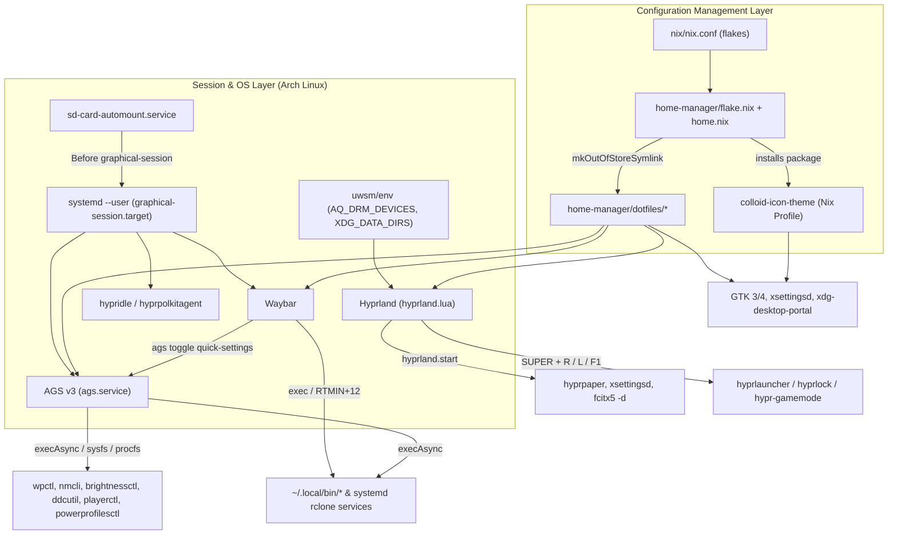

# DIYDesktopEnvironment

A modular, Wayland-first Arch Linux desktop configuration built around **Hyprland** (Lua configuration API), **Waybar**, **AGS v3** (GTK4/TypeScript), **UWSM**, and **Home Manager** (`nix` flakes), styled consistently with a **Catppuccin Mocha + Electric Blue** frosted-glass aesthetic.

[](https://github.com/Darkitsuki/DIYDesktopEnvironment/commits/main)
[](https://github.com/Darkitsuki/DIYDesktopEnvironment)
[](https://github.com/Darkitsuki/DIYDesktopEnvironment)

> **Scope Note:** This repository is a version-controlled `~/.config` (`XDG_CONFIG_HOME`) dotfiles tree paired with a Nix Home Manager flake for an **Arch Linux (`x86_64`)** hybrid-GPU laptop setup—not a standalone Linux distribution or packaged Desktop Environment installer. Several helper scripts referenced by absolute path under `~/.local/bin/` and `~/.local/share/nautilus/scripts/` reside outside this repository and are documented explicitly below.

---

## Table of Contents

- [Project Overview](#project-overview)
- [Features](#features)
- [Screenshots and Visual Preview](#screenshots-and-visual-preview)
- [Technology Stack](#technology-stack)
- [System Architecture](#system-architecture)
- [Repository Structure](#repository-structure)
- [Requirements and Dependencies](#requirements-and-dependencies)
- [Installation Guide](#installation-guide)
- [Configuration and Customization Guide](#configuration-and-customization-guide)
- [Custom Modules and Scripts](#custom-modules-and-scripts)
- [Troubleshooting](#troubleshooting)
- [Backup and Recovery](#backup-and-recovery)
- [Contributing](#contributing)
- [Security Considerations](#security-considerations)
- [License](#license)
- [Acknowledgements](#acknowledgements)
- [Author and Project Links](#author-and-project-links)

---

## Project Overview

### What is DIYDesktopEnvironment?

`DIYDesktopEnvironment` is a customized Linux desktop configuration and dotfiles repository designed to assemble a cohesive desktop experience out of standalone Wayland components rather than using a monolithic desktop suite (such as GNOME or KDE Plasma).

To state its nature precisely:

- **What it is:** A customized Linux desktop configuration and collection of desktop-related dotfiles, Home Manager declarations, and systemd user services stored directly at `~/.config`.
- **What it is not:** It is not a full NixOS system configuration (there is no root `nixosConfigurations` flake) and not a self-contained, distro-agnostic desktop package. Core system binaries (`hyprland`, `waybar`, `ags`, `uwsm`, `fcitx5`, `nautilus`, NVIDIA/Intel drivers) are expected from the host Arch Linux system, while Nix + Home Manager manage user-space config symlinks and select Nix-provided packages (`colloid-icon-theme`).

### Problem Solved and Design Principles

Building a Hyprland desktop from individual tools often leads to visual inconsistency across GTK3/GTK4 dialogs, missing environment variables under display-manager launches, conflicting idle/lock behavior, and fragile dotfile symlinks. This repository addresses those issues through four core principles:

1. **Out-of-Store Declarative Linking:** `home-manager/home.nix` uses `config.lib.file.mkOutOfStoreSymlink` for seven core config directories (`ags`, `hypr`, `waybar`, `gtk-3.0`, `gtk-4.0`, `xsettingsd`, `xdg-desktop-portal`), allowing live edits inside `home-manager/dotfiles/` to take effect immediately without rebuilding the Nix store on every tweak.
2. **Unified Visual Language:** Hyprland, `hyprlock`, `hyprlauncher`, `hyprtoolkit`, Waybar, AGS, GTK3, and GTK4 share a Catppuccin Mocha (`#1e1e2e` / `#181825` / `#313244`) and Electric Blue (`#288cff` / `#89b4fa`) palette with `Roboto` UI typography and `JetBrainsMono Nerd Font` monospace/icon glyphs.
3. **UWSM + systemd Session Integration:** Session environment variables (`uwsm/env`), DRM device ordering (`AQ_DRM_DEVICES`), and XDG data directories (`$HOME/.nix-profile/share`) are exported before the compositor starts, while background daemons and sync jobs integrate with systemd user targets.
4. **Hardware-Aware Ergonomics:** Configured for a hybrid Intel iGPU + NVIDIA dGPU laptop (`eDP-1` 144Hz internal panel + `HDMI-A-2` 180Hz external monitor with optional 10-bit HDR toggling and DDC/CI brightness control, plus D3cold-safe GPU telemetry).

### Intended Audience

- Arch Linux users running Hyprland (`0.57+` with Lua configuration support) who want a reference Wayland desktop setup using UWSM, Waybar, and AGS v3.
- Developers interested in combining host-managed Arch Linux Wayland packages with Nix Home Manager (`mkOutOfStoreSymlink`) for dotfile and icon-theme management.
- Users looking for practical examples of AGS v3 (`ags/gtk4` + `gnim` + `Astal`) Quick Settings widgets, GTK3/GTK4 file-chooser theming, and Rclone two-way SD card synchronization.

---

## Features

### Window Management

- **Lua-Based Hyprland Configuration:** Uses Hyprland's Lua API (`hl.config`, `hl.bind`, `hl.window_rule`, `hl.layer_rule`, `hl.monitor`, `hl.gesture`) in `home-manager/dotfiles/hypr/hyprland.lua` with modular GUI overrides in `home-manager/dotfiles/hypr/hyprland-gui.lua` (generated by HyprMod).
- **Dwindle Tiling & Multi-Layout Readiness:** Defaults to `dwindle` (`preserve_split = true`, `gaps_in = 5`, `gaps_out = 10`, `rounding = 10`), with `master` and `scrolling` blocks preconfigured.
- **Custom Animations & Blur:** Uses Bezier curves (`easeOutQuint`, `easeInOutCubic`, `linear`, `almostLinear`, `quick`) and a spring curve (`easy`), plus frosted-glass layer blur rules for `quick-settings` and `hyprlauncher`.
- **Gaming & Application Window Rules:** Enables tearing (`allow_tearing = true` and `immediate = true` for `^steam_app_.*$`), disables blur/shadow/animations for Minecraft (`Minecraft.*`), and floats/centers `nautilus`, `xdg-desktop-portal-gtk`, `xdg-desktop-portal-gnome` file choosers, `org.gnome.NautilusPreviewer` (Sushi), `steam`, `pavucontrol`, `kitty` (`nmtui`), `CurseForge`, and `minecraft-launcher`.

### Workspace Management

- **Persistent Primary Workspace:** Pins workspace `1` as persistent and default on `eDP-1`.
- **Keyboard, Mouse & Gesture Navigation:** Supports `SUPER + [0-9]` to focus workspaces 1–10, `SUPER + SHIFT + [0-9]` to move windows, `SUPER + mouse_down/up` to cycle workspaces, and a 3-finger horizontal touchpad swipe gesture (`hl.gesture`).
- **Waybar Workspace Indicator:** Displays persistent workspaces `1`–`5` across outputs with scroll-wheel switching via `hyprctl dispatch 'hl.dsp.focus(...)'`.

### Status Bar

- **Floating Translucent Pill Bar (`Waybar`):** Configured in `home-manager/dotfiles/waybar/config.jsonc` and styled in `home-manager/dotfiles/waybar/style.css`.
- **Active Top-Bar Layout:**
  - **Left:** `clock` (calendar tooltip, click toggles `YYYY-MM-DD`) and `hyprland/workspaces`.
  - **Center:** `custom/playerctl` (shows `title - artist`, click play/pause, scroll next/previous).
  - **Right:** `pulseaudio` (click opens `pavucontrol`), `network` (click opens `kitty -e nmtui`), `custom/gdrive-sync` (live sync status, file progress tooltip, click/right-click/middle-click actions), `battery`, `tray`, and `custom/quick-settings` (toggles AGS `quick-settings`).
- **Additional Predefined Modules:** `config.jsonc` also defines `custom/gpu-temp`, `custom/hdr`, `custom/external-brightness`, `custom/power-profile`, `custom/power` (with `power_menu.xml`), `cpu`, `memory`, `temperature`, `backlight`, `keyboard-state`, and `idle_inhibitor` for users who wish to enable them in `modules-*`.

### Quick Settings (AGS v3)

- **Floating GTK4 Popup (`home-manager/dotfiles/ags/`):** Built with AGS `3.1.0` (`ags/gtk4`, `Astal`, `gnim`), launched via `ags run` and toggled with `ags toggle quick-settings` (plus a `quicksettings` window alias and a fullscreen `Backdrop` click-away overlay + `Escape` key handler).
- **Header Bar (`widget/Header.tsx`):** Shows live system uptime (`/proc/uptime`), `BAT0` capacity/charging badge, region screenshot button (`grim` + `slurp` + `wl-copy`), AGS service restart button (`systemctl --user restart ags.service`), and a `wofi` power menu button.
- **2x4 Quick Toggles (`widget/QuickToggles.tsx`):**
  - **Wi-Fi** (`nmcli` toggle, right-click launches `kitty --title nmtui -e nmtui`).
  - **Bluetooth** (`bluetoothctl` / `rfkill` toggle, right-click launches `blueman-manager`).
  - **Power Profile** (`powerprofilesctl` cycles `balanced` -> `performance` -> `power-saver`).
  - **Game Mode** (toggles `$HOME/.local/bin/hypr-gamemode` and monitors `/tmp/hypr-gamemode.active`).
  - **HDR (`HDMI-A-2`)** (toggles 8-bit SDR / 10-bit HDR via `$HOME/.local/bin/hypr-hdr-toggle`).
  - **Do Not Disturb** (triggers `dunstctl` and `makoctl` pause/mode toggles).
  - **Keep Awake** (stops/starts `hypridle.service` via `systemctl --user`).
  - **Lock Screen** (closes popup and runs `pidof hyprlock || hyprlock`).

### Audio, Brightness & Media Management

- **PipeWire / WirePlumber Sliders & Keys:** AGS `services/audio.ts` and `Sliders.tsx` poll and control `@DEFAULT_AUDIO_SINK@` and `@DEFAULT_AUDIO_SOURCE@` via `wpctl`; Hyprland binds `XF86AudioRaiseVolume`, `XF86AudioLowerVolume`, `XF86AudioMute`, and `XF86AudioMicMute` (`locked = true`, `repeating = true`).
- **Dual Display Brightness Control:** AGS controls laptop backlight (`eDP-1`) via `brightnessctl` and automatically reveals an external monitor brightness slider when `HDMI-A-2` is connected (`hyprctl monitors -j`), adjusting brightness over DDC/CI with `ddcutil --display 1` (150 ms debounced).
- **MPRIS Media Card (`widget/MediaCard.tsx` & `services/mpris.ts`):** Dynamically appears inside Quick Settings when a player is `Playing` or `Paused` via `playerctl`, providing track/artist labels and prev/play-pause/next controls; Hyprland also maps `XF86AudioNext/Pause/Play/Prev`.

### Power & Idle Management

- **Automated Idle Pipeline (`home-manager/dotfiles/hypr/hypridle.conf`):**
  - `150s`: dims screen via `brightnessctl -s set 15` (restores on resume).
  - `300s`: locks session via `loginctl lock-session`.
  - `330s`: turns off displays via `hyprctl dispatch dpms off`.
  - `1800s`: suspends system via `systemctl suspend`.
  - Integrates with `before_sleep_cmd` (`loginctl lock-session`) and `after_sleep_cmd` (`hyprctl dispatch dpms on`).
- **Frosted-Glass Lock Screen (`home-manager/dotfiles/hypr/hyprlock.conf`):** Vertical `JetBrainsMono Nerd Font` hour/minute clock, date, `$USER` badge, blurred wallpaper background, and pill password field with Caps Lock, check, and failure feedback colors.

### System Monitoring

- **AGS Telemetry Strip (`widget/SystemStats.tsx`):** Polls CPU usage (`/proc/stat` delta, 2.5s), RAM usage (`/proc/meminfo`, 3s), CPU package temperature (`hwmon` `coretemp`/`k10temp` or `thermal_zone`, 3s), and NVIDIA GPU temperature (`waybar-gpu-temp`, 3s, D3cold-aware) with `normal`, `warning`, `critical`, and `suspended` visual states.
- **Terminal Monitor (`btop/btop.conf`):** Configured with Nord theme (`/usr/share/btop/themes/nord.theme`), transparent background (`theme_background = false`), braille graphs, and tree process view.

### Input Method Management

- **Fcitx5 + Unikey (`fcitx5/`):** Autostarted in `hyprland.lua` (`fcitx5 -d`) with `XMODIFIERS=@im=fcitx`, `QT_IM_MODULE=fcitx`, and `GTK_IM_MODULE=fcitx`. `fcitx5/profile` configures `keyboard-us` and Vietnamese `unikey` (`DefaultIM=unikey`), toggled via `Super+space`, `Shift_L`, or `Control+space` (`fcitx5/config`).

### File Management & Cloud Sync Automation

- **Nautilus + Portal Integration:** `nautilus` is bound to `SUPER + E` and set as default for `inode/directory` in `mimeapps.list`; `xdg-desktop-portal/portals.conf` routes `org.freedesktop.impl.portal.FileChooser=gnome` and `default=hyprland;gtk`.
- **SD Card & Google Drive Sync (`systemd/user/` & `rclone/`):**
  - `systemd/user/sd-card-automount.service` auto-mounts the configured SD card partition (`<SD_CARD_UUID>`) via `udisksctl` before `graphical-session.target` and notifies Waybar (`RTMIN+12`).
  - `systemd/user/rclone-gdrive-sd.service` and `rclone-gdrive-sd-fast.service` run `%h/.local/bin/mirror-gdrive-sd.sh` (full and `--fast` modes) with `TimeoutStopSec=45s`.
  - `rclone/config-backup-exclude.txt` defines cache/runtime exclusion patterns for `~/.config` backups.
- **Secondary File Manager Configs:** Also includes configuration files for Thunar (`Thunar/`, `xfce4/xfconf/xfce-perchannel-xml/thunar.xml`) and Dolphin (`dolphinrc`, `baloofileinformationrc`).

### Theme and Appearance

- **GTK3 & GTK4 / Libadwaita (`home-manager/dotfiles/gtk-3.0/`, `gtk-4.0/`):** Compact Catppuccin Mocha + Electric Blue styling (`gtk.css`) over `Adwaita:dark` / `Adwaita`, `Colloid-Catppuccin-Dark-Nautilus` icons, `Roboto 11` font, and `Adwaita` 24px cursors, mirrored in `xsettingsd/xsettingsd.conf` and `nwg-look/config`.
- **Fontconfig (`fontconfig/fonts.conf`):** Maps `sans-serif` to `Noto Sans`, `Symbols Nerd Font`, `Noto Color Emoji` and `monospace` to `JetBrainsMono Nerd Font`, `Symbols Nerd Font`.
- **Hyprland Ecosystem Styling:** `hyprtoolkit.conf` and `hyprlauncher.conf` extend the same palette and `Roboto` / `JetBrainsMono Nerd Font` typography to `hyprlauncher` and Hyprland toolkit apps.

---

## Screenshots and Visual Preview

No screenshot images are currently included in this repository. A dedicated [screenshots/](screenshots/README.md) directory has been prepared with naming guidelines for contributors or users capturing their own session.

Once screenshots are added to `screenshots/`, they map to the following views:

| Preview Slot | Expected Path | What It Shows |
| --- | --- | --- |
| 1. Desktop Overview | `screenshots/desktop-overview.png` | Hyprland workspace with wallpaper (`hyprpaper`), floating/tiled windows, and Waybar |
| 2. Waybar Status Bar | `screenshots/waybar-status-bar.png` | Top translucent pill bar with workspaces, `playerctl`, `gdrive-sync`, audio, network, and tray |
| 3. Quick Settings | `screenshots/quick-settings.png` | AGS v3 floating Quick Settings panel (telemetry strip, 2x4 toggles, sliders, MPRIS card) |
| 4. Application Launcher | `screenshots/application-launcher.png` | `hyprlauncher` centered 620x430 Spotlight-style launcher |
| 5. File Manager | `screenshots/file-manager.png` | Nautilus styled with `gtk-4.0/gtk.css` and `Colloid-Catppuccin-Dark-Nautilus` icons |
| 6. System Monitoring | `screenshots/system-monitoring.png` | `btop` (`btop/btop.conf`) alongside AGS `SystemStats` telemetry |

To capture any view using the configured screenshot command:

```bash
grim -g "$(slurp)" screenshots/desktop-overview.png
```

---

## Technology Stack

| Technology | Purpose | Documentation |
| --- | --- | --- |
| **Arch Linux** | Host operating system (`x86_64`) providing system packages and drivers | [ArchWiki](https://wiki.archlinux.org/) |
| **Nix** | Reproducible package manager with flakes enabled (`nix/nix.conf`) | [Nix Reference Manual](https://nixos.org/manual/nix/stable/) |
| **Home Manager** | User environment & out-of-store dotfile symlink management (`home-manager/`) | [Home Manager Manual](https://nix-community.github.io/home-manager/) |
| **UWSM** | Wayland session launcher exporting environment variables (`uwsm/env`) | [UWSM GitHub](https://github.com/Vladimir-csp/uwsm) |
| **Hyprland** | Dynamic tiling Wayland compositor configured in Lua (`hyprland.lua`) | [Hyprland Wiki](https://wiki.hypr.land/) |
| **Hyprlock / Hypridle / Hyprpaper / Hyprlauncher** | Lock screen, idle daemon, wallpaper daemon, and app launcher | [Hypr Ecosystem Wiki](https://wiki.hypr.land/Hypr-Ecosystem/) |
| **Waybar** | Top status bar with custom JSON/script modules (`waybar/config.jsonc`) | [Waybar Wiki](https://github.com/Alexays/Waybar/wiki) |
| **AGS v3 (Astal / gnim)** | GTK4/TypeScript widget framework powering the Quick Settings popup | [AGS / Aylur Docs](https://aylur.github.io/ags/) |
| **GTK 3 & GTK 4 / Libadwaita** | Application toolkit theming (`gtk-3.0/gtk.css`, `gtk-4.0/gtk.css`) | [GTK Documentation](https://docs.gtk.org/) |
| **xsettingsd & xdg-desktop-portal** | Runtime XWayland GTK settings & Wayland file-chooser/screencast portals | [xdg-desktop-portal Docs](https://flatpak.github.io/xdg-desktop-portal/) |
| **Fcitx5 (+ Unikey)** | Wayland/XWayland input method framework for English & Vietnamese | [Fcitx5 Wiki](https://fcitx-im.org/wiki/Fcitx_5) |
| **Fontconfig** | System font fallback & Nerd Font symbol aliases (`fontconfig/fonts.conf`) | [Fontconfig User Guide](https://www.freedesktop.org/software/fontconfig/fontconfig-user.html) |
| **systemd (user)** | Session services (`ags.service`, `waybar.service`, `hypridle.service`, sync units) | [systemd User Units](https://wiki.archlinux.org/title/Systemd/User) |
| **Rclone** | Bidirectional Google Drive <-> SD card synchronization (`rclone bisync`) | [Rclone Bisync Docs](https://rclone.org/bisync/) |

---

## System Architecture

### Architectural Layers

1. **Operating System & Hardware Layer (Arch Linux + systemd):** Manages Linux kernel DRM/KMS devices (`/dev/dri/dgpu`, `/dev/dri/igpu`), NVIDIA/Intel graphics drivers, PipeWire/WirePlumber, NetworkManager, BlueZ, `power-profiles-daemon`, `udisks2`, and systemd user targets.
2. **Configuration Management Layer (Nix + Home Manager):** `nix/nix.conf` enables `nix-command` and `flakes`. `home-manager/flake.nix` evaluates `home-manager/home.nix` (`homeConfigurations."<your-username>"`), installs `colloid-icon-theme` (Catppuccin variant), and links the seven core config directories from `~/.config/home-manager/dotfiles/` into `~/.config/` via `mkOutOfStoreSymlink`.
3. **Display Server & Session Layer (SDDM -> UWSM -> systemd):** `uwsm/env` sets `AQ_DRM_DEVICES` and adds `$HOME/.nix-profile/share` to `XDG_DATA_DIRS` before starting the compositor, ensuring Nix-installed icons and multi-GPU DRM priority are available across the `graphical-session.target`.
4. **Window Management Layer (Hyprland Lua + Hypr Ecosystem):** `hyprland.lua` configures monitors, workspaces, input devices, animations, window/layer rules, keybindings, and Wayland/IM environment variables. On `hyprland.start`, it spawns `hyprpaper`, `xsettingsd`, and `fcitx5 -d`, while `waybar`, `ags`, `hypridle`, and `hyprpolkitagent` are managed as systemd user services under `graphical-session.target` (with `sd-card-automount.service` ordered `Before=graphical-session.target`).
5. **Desktop UI Layer (Waybar + AGS v3):** Waybar renders persistent workspaces, clock, MPRIS playback, network, battery, tray, and custom script modules. Clicking `custom/quick-settings` invokes `ags toggle quick-settings` via Astal IPC, opening the GTK4 Quick Settings popup, which polls system files (`/proc/*`, `/sys/class/*`) and executes CLI utilities (`wpctl`, `nmcli`, `brightnessctl`, `ddcutil`, `powerprofilesctl`, `playerctl`, `systemctl`, and external `~/.local/bin/` helpers).
6. **Application & Portal Layer:** `xdg-desktop-portal` (`hyprland;gtk` + `gnome` file chooser), GTK3/GTK4 CSS overrides, `xsettingsd`, `fontconfig`, `nautilus`, `kitty`, `btop`, `pavucontrol`, and `antigravity-flags.conf` (`--password-store=gnome-libsecret`).

### Architecture & Data-Flow Diagram



---

## Repository Structure

The tree below reflects the **tracked source layout** of the repository (excluding runtime caches, Electron/browser directories, and untracked files ignored by `.gitignore`):

```text
DIYDesktopEnvironment/                      (cloned as ~/.config)
├── .config.code-workspace                  # VS Code multi-root workspace descriptor
├── .gitignore                              # Ignores caches, browser/IDE state, secrets, systemd/
├── ags -> /nix/store/.../.config/ags       # Symlink managed by Home Manager (out-of-store -> dotfiles/ags)
├── antigravity-flags.conf                  # Electron flag: --password-store=gnome-libsecret
├── antigravity-ide-flags.conf              # Electron flag: --password-store=gnome-libsecret
├── baloofileinformationrc                  # KDE Baloo metadata display preferences
├── btop/
│   └── btop.conf                           # btop++ configuration (Nord theme, transparent background)
├── dolphinrc                               # Dolphin file manager preferences
├── environment.d/
│   └── 10-home-manager.conf -> /nix/store/... # Sets LOCALE_ARCHIVE_2_27 from Nix glibc-locales
├── fcitx/
│   └── dbus/                               # Tracked D-Bus address file (note: fcitx/dbus/ is in .gitignore)
├── fcitx5/
│   ├── conf/
│   │   ├── cached_layouts                  # XKB keyboard layout cache
│   │   └── notifications.conf              # Fcitx5 notification suppression settings
│   ├── config                              # Fcitx5 hotkeys (Super+Space, Shift_L, Ctrl+Space) & behavior
│   └── profile                             # Default group: keyboard-us + unikey
├── fontconfig/
│   └── fonts.conf                          # sans-serif & monospace font fallback aliases
├── gtk-3.0 -> /nix/store/.../.config/gtk-3.0
├── gtk-3.0.bak/                            # Pre-Catppuccin backup snapshot (Moga-Dark)
├── gtk-4.0 -> /nix/store/.../.config/gtk-4.0
├── gtk-4.0.bak/                            # Pre-Catppuccin backup snapshot (Moga-Dark)
├── home-manager/
│   ├── flake.lock                          # Pinned nixpkgs-unstable & home-manager revisions
│   ├── flake.nix                           # Flake entrypoint defining homeConfigurations."<your-username>"
│   ├── home.nix                            # Username, packages, and 7 mkOutOfStoreSymlink mappings
│   └── dotfiles/                           # Authoritative source directory for core desktop configs
│       ├── ags/                            # AGS v3 Quick Settings (TypeScript/TSX + GTK4 CSS)
│       │   ├── app.ts                      # Entrypoint: initializes Backdrop, QuickSettings, alias
│       │   ├── app.js.v1_backup            # Legacy AGS v1 backup (unused)
│       │   ├── env.d.ts                    # TypeScript ambient module declarations (*.css, inline:*)
│       │   ├── package.json                # ags & gnim dependencies
│       │   ├── style.css                   # Catppuccin Mocha + Electric Blue GTK4 CSS
│       │   ├── style.css.v1_backup         # Legacy AGS v1 CSS backup (unused)
│       │   ├── tsconfig.json               # JSX/TS configuration (jsxImportSource: ags/gtk4)
│       │   ├── services/                   # State pollers & CLI wrappers (audio, brightness, gamemode, hdr, mpris, network, system)
│       │   └── widget/                     # UI components (Backdrop, Header, SystemStats, QuickToggles, Sliders, MediaCard, QuickSettings)
│       ├── gtk-3.0/                        # GTK3 settings.ini, bookmarks, custom compact Catppuccin gtk.css
│       ├── gtk-4.0/                        # GTK4/Libadwaita settings.ini, custom Nautilus/FileChooser gtk.css
│       ├── hypr/                           # Hyprland & Hypr ecosystem configs
│       │   ├── hypridle.conf               # Idle dim (150s), lock (300s), DPMS (330s), suspend (1800s)
│       │   ├── hyprland-gui.lua            # HyprMod-generated overrides (disables borderangle anim)
│       │   ├── hyprland.lua                # Main Lua compositor config
│       │   ├── hyprlauncher.conf           # 620x430 launcher with uwsm app -- prefix
│       │   ├── hyprlock.conf               # Catppuccin Mocha lock screen
│       │   ├── hyprpaper.conf              # Per-monitor wallpaper paths (eDP-1 & fallback)
│       │   └── hyprtoolkit.conf            # Frosted-glass palette & Colloid-Catppuccin-Dark icon theme
│       ├── waybar/
│       │   ├── config.jsonc                # Status bar layout and built-in/custom modules
│       │   ├── power_menu.xml              # GTK menu definition for custom/power
│       │   └── style.css                   # Pill styling, Catppuccin colors, status classes
│       ├── xdg-desktop-portal/
│       │   ├── hyprland-portals.conf       # Portal backend preferences for Hyprland
│       │   └── portals.conf                # Default=hyprland;gtk, FileChooser=gnome
│       └── xsettingsd/
│           └── xsettingsd.conf             # XWayland GTK theme, icon theme, font, cursor settings
├── hypr -> /nix/store/.../.config/hypr
├── mimeapps.list                           # Default apps (Nautilus for directories, VS Code for text/TS/CSS)
├── nix/
│   └── nix.conf                            # Enables nix-command and flakes
├── nwg-look/
│   └── config                              # nwg-look GTK export flags
├── pavucontrol.ini                         # PulseAudio Volume Control window/filter preferences
├── rclone/
│   └── config-backup-exclude.txt           # Exclusion rules for ~/.config backups
├── rncbc.org/
│   └── Qtractor.conf                       # Qtractor DAW configuration
├── screenshots/
│   └── README.md                           # Placeholder guide for visual previews
├── systemd/
│   └── user/                               # Tracked user units (forced past .gitignore's systemd/ rule)
│       ├── rclone-gdrive-sd-fast.service   # Fast 2-way Google Drive sync (excludes Shared Modpack)
│       ├── rclone-gdrive-sd.service        # Full 2-way Google Drive sync
│       └── sd-card-automount.service       # Automounts SD card UUID via udisksctl before graphical-session
├── Thunar/                                 # Thunar custom actions (uca.xml) & shortcuts (accels.scm)
├── user-dirs.dirs                          # XDG user directories (includes XDG_PROJECTS_DIR)
├── user-dirs.locale                        # en_US
├── uwsm/
│   └── env                                 # UWSM session env (AQ_DRM_DEVICES, XDG_DATA_DIRS)
├── waybar -> /nix/store/.../.config/waybar
├── xdg-desktop-portal -> /nix/store/.../.config/xdg-desktop-portal
├── xfce4/                                  # Thunar xfconf settings
├── xsettingsd -> /nix/store/.../.config/xsettingsd
└── xsettingsd.bak/                         # Pre-Catppuccin backup snapshot
```

> **Tracked vs. Unmanaged Files Note:** Because this repo tracks `~/.config` directly, the root-level symlinks (`ags`, `hypr`, `waybar`, `gtk-3.0`, `gtk-4.0`, `xsettingsd`, `xdg-desktop-portal`, `environment.d/10-home-manager.conf`) currently point to a specific `/nix/store/<hash>-home-manager-files/...` path in Git. Running `home-manager switch` on a different machine or user will replace those local symlinks with your own Nix store generation.

---

## Requirements and Dependencies

### System Requirements

- **Operating System:** **Arch Linux (`x86_64`)** (verified in `/etc/os-release` and assumed by systemd unit paths such as `/usr/bin/ags`, `/usr/bin/udisksctl`, `/usr/lib/systemd/user/*`, and `/usr/share/btop/themes/nord.theme`). Other distributions may work if adapted, but are **not verified**.
- **Wayland Session & Display Manager:** A Wayland-capable GPU driver stack and UWSM (`uwsm`). Current configuration targets a dual-GPU laptop (`AQ_DRM_DEVICES=/dev/dri/dgpu:/dev/dri/igpu`) with an NVIDIA dGPU (`LIBVA_DRIVER_NAME=nvidia`, `__GLX_VENDOR_LIBRARY_NAME=nvidia`) and Intel backlight (`brightnessctl`).
- **Nix & Home Manager:** Nix with Flakes support (`nix` `2.36.0` and `home-manager` `26.11-pre` observed on the reference system; `home.stateVersion = "26.05"`).
- **Reference-Machine Hardware Settings (must be adapted to your host):**
  - Laptop internal display `eDP-1` (`1920x1080@144`) and optional external monitor `HDMI-A-2` (`1920x1080@180` with DDC/CI and HDR support).
  - Battery sysfs node at `/sys/class/power_supply/BAT0` (used by `ags/services/system.ts`).
  - NVIDIA PCI device at `0000:01:00.0` (reference-machine dGPU PCI address, used by `waybar-gpu-temp`).
  - SD card partition UUID `<SD_CARD_UUID>` (configured in `sd-card-automount.service` and `gtk-3.0/bookmarks`; replace with your storage device's UUID).

### Required Dependencies (Core Desktop)

Install these on Arch Linux (via `pacman` or AUR where applicable) for the core compositor, bar, Quick Settings, portals, and input method:

| Package / Tool | Purpose |
| --- | --- |
| `hyprland` (`>= 0.57` with Lua config support) | Wayland compositor (`hyprland.lua`) |
| `uwsm` | Wayland session management (`uwsm/env`, `uwsm app --`) |
| `hyprpaper`, `hyprlock`, `hypridle`, `hyprlauncher`, `hyprpolkitagent` | Wallpaper, lock screen, idle daemon, launcher, polkit agent |
| `waybar` | Top status bar |
| `aylurs-gtk-shell` (`ags` v3) + `libastal-*` / `gnim` | AGS v3 GTK4 Quick Settings popup |
| `kitty` | Default terminal (`SUPER + Q`, `nmtui`, log viewer) |
| `nautilus` | Default file manager (`SUPER + E`) |
| `xdg-desktop-portal`, `xdg-desktop-portal-hyprland`, `xdg-desktop-portal-gtk`, `xdg-desktop-portal-gnome` | Screencasting and GNOME/GTK file choosers |
| `xsettingsd` | Runtime XWayland GTK settings synchronization |
| `pipewire`, `wireplumber` (`wpctl`), `pavucontrol` | Audio server, CLI volume control, GUI mixer |
| `networkmanager` (`nmcli`, `nmtui`) | Wi-Fi & network state management |
| `brightnessctl` | Internal display backlight control & idle dimming |
| `playerctl` | MPRIS media metadata & playback control |
| `grim`, `slurp`, `wl-copy` (`wl-clipboard`) | Region screenshots to clipboard |
| `fcitx5`, `fcitx5-unikey` (plus Qt/GTK IM modules) | Input method framework & Vietnamese typing |
| `ttf-jetbrains-mono-nerd`, `ttf-roboto`, `noto-fonts`, `noto-fonts-emoji`, `ttf-nerd-fonts-symbols` | Fonts referenced in `fontconfig`, `waybar`, `ags`, `hyprlock`, `hyprtoolkit` |
| `libnotify` (`notify-send`) | Desktop notifications from scripts and AGS actions |
| `wofi` | Power menu dmenu dialog (`ags/services/system.ts` `openPowerMenu`) |

### Optional Dependencies

| Package / Tool | Purpose |
| --- | --- |
| `ddcutil` | External monitor (`HDMI-A-2`) brightness control in AGS & Waybar |
| `nvidia-utils` (`nvidia-smi`) | GPU temperature/power telemetry (`waybar-gpu-temp`) |
| `power-profiles-daemon` (`powerprofilesctl`) | Power profile cycling in AGS & Waybar |
| `bluez` (`bluetoothctl`), `rfkill`, `blueman` (`blueman-manager`) | Bluetooth toggle & manager GUI in AGS |
| `dunst` or `mako` | Notification daemon for AGS Do Not Disturb (`dunstctl` / `makoctl`) |
| `rclone`, `udisks2` (`udisksctl`) | Google Drive <-> SD card 2-way sync & automounting |
| `sushi` (`org.gnome.NautilusPreviewer`) | Quick Look previewer matched in Hyprland window rules |
| `btop` | Terminal system monitor (`btop/btop.conf`) |
| `nwg-look` | GTK theme configuration helper (`nwg-look/config`) |
| `lua` (`luac`) | Syntax validation inside external `hypr-hdr-toggle` script |
| `hyprshutdown` | Graceful compositor shutdown (`SUPER + M`, falls back to `hyprctl`) |
| `thunar`, `dolphin`, `qtractor`, `steam` | Secondary apps with configs/rules present in the repo |

---

## Installation Guide

> **Caution:** This repository is structured to live directly at `~/.config`. Applying Home Manager or cloning directly over an existing `~/.config` will overwrite existing desktop configurations. **Back up `~/.config` first** (see [Backup and Recovery](#backup-and-recovery)).

### 1. Prepare the Arch Linux Environment

Ensure your base Arch Linux system is up to date, Wayland/GPU drivers are configured, and `git` is installed:

```bash
sudo pacman -Syu git base-devel
```

### 2. Install Nix and Enable Flakes

Install Nix on Arch Linux (for example, using the `nix` Arch package or the upstream Determinate/official installer—consult the [ArchWiki Nix page](https://wiki.archlinux.org/title/Nix) for your preferred setup). If using Arch's `nix` package:

```bash
sudo pacman -S nix
sudo systemctl enable --now nix-daemon.service
sudo usermod -aG nix-users "$USER"
# Log out and back in so group membership and Nix profile paths take effect
```

Ensure `experimental-features = nix-command flakes` is active (this repo provides `nix/nix.conf` for `~/.config/nix/nix.conf`).

### 3. Install System Dependencies

Install the core Wayland, Hyprland, Bar, Widget, Portal, Font, and Audio packages on Arch Linux (adjust AUR packages such as `aylurs-gtk-shell` / `ags` or `hyprlauncher` using your preferred AUR helper if not in official repos):

```bash
sudo pacman -S \
  hyprland uwsm hyprpaper hyprlock hypridle hyprpolkitagent \
  waybar kitty nautilus xsettingsd \
  xdg-desktop-portal xdg-desktop-portal-hyprland xdg-desktop-portal-gtk xdg-desktop-portal-gnome \
  pipewire wireplumber pavucontrol networkmanager brightnessctl playerctl \
  grim slurp wl-clipboard libnotify wofi \
  fcitx5 fcitx5-unikey \
  ttf-jetbrains-mono-nerd ttf-roboto noto-fonts noto-fonts-emoji ttf-nerd-fonts-symbols
```

Install optional hardware/sync tools as needed:

```bash
sudo pacman -S ddcutil power-profiles-daemon bluez bluez-utils blueman rclone udisks2 btop dunst
```

> **Note:** Check exact AUR package names for `ags` v3 (for example `aylurs-gtk-shell-git` or `ags`) and `hyprlauncher` before installing, and ensure `ags --version` reports v3.x (`3.1.0` on the reference system) with `gnim` and `Astal` typelibs available.

### 4. Back Up Existing `~/.config` and Clone the Repository

Back up your existing configuration before cloning into `~/.config`:

```bash
mv ~/.config ~/.config.backup.$(date +%Y%m%d-%H%M%S)
git clone https://github.com/Darkitsuki/DIYDesktopEnvironment.git ~/.config
cd ~/.config
```

### 5. Inspect and Customize Machine-Specific Settings

Before running Home Manager, update hardcoded usernames, home paths, wallpapers, monitors, and hardware devices:

1. **`home-manager/flake.nix`**: Replace the hardcoded username in `homeConfigurations."<your-username>"` with your Linux username (or pass `--flake ~/.config/home-manager#<your-username>`).
2. **`home-manager/home.nix`**: Update `home.username` and `home.homeDirectory`:
   ```nix
   home.username = "<your-username>";
   home.homeDirectory = "/home/<your-username>";
   ```
3. **`home-manager/dotfiles/hypr/hyprland.lua`**:
   - Review the reference `hl.monitor(...)` entries (`eDP-1`, `HDMI-A-2`) to match your actual display names (`hyprctl monitors`), resolutions, and refresh rates.
   - Update `hl.env("LIBVA_DRIVER_NAME", "nvidia")` / `__GLX_VENDOR_LIBRARY_NAME` if you are not on NVIDIA.
   - Update the hardcoded `$HOME/.local/bin/hypr-gamemode` path (in the `SUPER + F1` binding) if using a custom path or script.
4. **`home-manager/dotfiles/hypr/hyprpaper.conf` & `hyprlock.conf`**:
   - Replace the hardcoded `$HOME/Pictures/Wallpapers/<wallpaper-file>` paths with valid wallpaper paths on your machine.
5. **`uwsm/env`**:
   - Verify `AQ_DRM_DEVICES=/dev/dri/dgpu:/dev/dri/igpu` (reference-machine udev symlinks) matches your `/dev/dri/` nodes (remove or adjust on single-GPU systems).
6. **`home-manager/dotfiles/waybar/config.jsonc` & `home-manager/dotfiles/ags/`**:
   - Update or remove hardcoded `$HOME/.local/bin/*` and `<SD_CARD_MOUNT>` (`/run/media/$USER/<SD_CARD_UUID>/...`) references if you do not use those external scripts or SD card sync services (see [Custom Modules and Scripts](#custom-modules-and-scripts)).
7. **`home-manager/dotfiles/gtk-3.0/bookmarks`** (and `systemd/user/sd-card-automount.service`):
   - Update `/home/<your-username>/...` bookmark paths and `<SD_CARD_UUID>` to match your username and storage device.

### 6. Apply the Home Manager Configuration

Run Home Manager using the repository flake (pass `-b backup` if Home Manager warns about pre-existing symlink targets from the cloned repo):

```bash
nix run home-manager/master -- switch --flake ~/.config/home-manager#<your-username> -b backup
```

If `home-manager` is already in your `PATH`:

```bash
home-manager switch --flake ~/.config/home-manager#<your-username> -b backup
```

This installs the Catppuccin variant of `colloid-icon-theme` into your Nix profile and recreates the out-of-store symlinks for `ags`, `hypr`, `waybar`, `gtk-3.0`, `gtk-4.0`, `xsettingsd`, and `xdg-desktop-portal` in `~/.config/`.

### 7. Set Up Systemd User Services (Manual Step)

Because `.gitignore` excludes `systemd/` (except the three explicitly tracked Google Drive/SD card unit files), `ags.service` and unit enablement symlinks (`graphical-session.target.wants/*`) are **not** automatically installed by cloning or running `home-manager switch`.

Create `~/.config/systemd/user/ags.service` if you want systemd to supervise AGS:

```ini
[Unit]
Description=Aylurs GTK Shell (AGS) Quick Settings Panel
PartOf=graphical-session.target
After=graphical-session.target

[Service]
Type=simple
ExecStart=/usr/bin/ags run
Restart=on-failure
RestartSec=1s

[Install]
WantedBy=graphical-session.target
```

Then enable the session services you installed:

```bash
systemctl --user daemon-reload
systemctl --user enable ags.service waybar.service hypridle.service hyprpolkitagent.service
```

Only enable `sd-card-automount.service` or `rclone-gdrive-sd*.service` if you have adapted the UUID/paths and created `~/.local/bin/mirror-gdrive-sd.sh` (see [Custom Modules and Scripts](#custom-modules-and-scripts)).

### 8. Start the Hyprland UWSM Session

From your display manager (e.g., SDDM), select the **Hyprland (uwsm-managed)** session, or start from a TTY via:

```bash
uwsm start hyprland-uwsm.desktop
```

---

## Configuration and Customization Guide

### User Environment & Nix

- **Username & Home Directory:** Edit `home-manager/flake.nix` (`homeConfigurations."..."`) and `home-manager/home.nix` (`home.username`, `home.homeDirectory`), then re-run `home-manager switch --flake ~/.config/home-manager#<user>`.
- **Nix Packages & Icon Theme:** Edit `home.packages` in `home-manager/home.nix` (currently installs `colloid-icon-theme` with `schemeVariants = [ "catppuccin" ]`).
- **Session & DRM Variables:** Edit `uwsm/env` (requires logging out and starting a fresh UWSM session).

### Hyprland (`home-manager/dotfiles/hypr/`)

- **Monitors & Workspaces:** Edit `hl.monitor({...})` and `hl.workspace_rule({...})` in `home-manager/dotfiles/hypr/hyprland.lua`.
- **Keybindings:** Edit `hl.bind(...)` entries in `hyprland.lua` (`mainMod = "SUPER"`).
- **Window & Layer Rules:** Add or adjust `hl.window_rule({...})` and `hl.layer_rule({...})` in `hyprland.lua`.
- **Animations & Look:** Adjust `general`, `decoration`, `animations`, `hl.curve(...)`, and `hl.animation(...)` in `hyprland.lua` (note `require("hyprland-gui")` at the bottom loads HyprMod overrides from `hyprland-gui.lua`).
- **Idle Timeouts & Lock Screen:** Edit `hypridle.conf` and `hyprlock.conf`.
- **Wallpapers & Launcher:** Edit `hyprpaper.conf` and `hyprlauncher.conf`. Reload Hyprland live with `hyprctl reload`.

### Waybar (`home-manager/dotfiles/waybar/`)

- **Enabled Modules & Order:** Edit `modules-left`, `modules-center`, and `modules-right` in `home-manager/dotfiles/waybar/config.jsonc`. For example, you can add `"custom/gpu-temp"`, `"custom/hdr"`, `"custom/external-brightness"`, or `"custom/power-profile"` (already defined in the file) into `modules-right`.
- **Styling & Colors:** Edit `home-manager/dotfiles/waybar/style.css` (uses `#c0caf5`, `#7aa2f7`, `#1e1e2e`, `#89b4fa`, and state classes `.warning`, `.critical`, `.suspended`, `.on`, `.off`, `.syncing`, `.error`).
- **Restart Waybar:** `systemctl --user restart waybar.service`.

### AGS Quick Settings (`home-manager/dotfiles/ags/`)

- **Panel Layout & Size:** Edit `home-manager/dotfiles/ags/widget/QuickSettings.tsx` (`widthRequest={380}`, `marginTop={8}`, `marginRight={12}`).
- **Quick Toggles:** Edit `home-manager/dotfiles/ags/widget/QuickToggles.tsx` to add/remove cards or rebind primary/secondary click handlers.
- **Sliders & Polling:** Edit `widget/Sliders.tsx`, `widget/SystemStats.tsx`, and `services/*.ts` to change polling intervals, hardware sysfs paths (e.g., `BAT0`), or external monitor output name (`HDMI-A-2`).
- **Theme CSS:** Edit `home-manager/dotfiles/ags/style.css`.
- **Reload AGS:** Click the reload icon in the Quick Settings header or run `systemctl --user restart ags.service`.

### Appearance (GTK3, GTK4, Fonts, Cursors)

- **GTK3 / GTK4 Themes & Icons:** Edit `home-manager/dotfiles/gtk-3.0/settings.ini`, `gtk-3.0/gtk.css`, `gtk-4.0/settings.ini`, `gtk-4.0/gtk.css`, and `home-manager/dotfiles/xsettingsd/xsettingsd.conf`.
- **GTK Bookmarks:** Edit `home-manager/dotfiles/gtk-3.0/bookmarks`.
- **Font Aliases:** Edit `fontconfig/fonts.conf` and run `fc-cache -fv`.
- **Hyprtoolkit Theme:** Edit `home-manager/dotfiles/hypr/hyprtoolkit.conf`.

### Input Method, File Managers & System Services

- **Fcitx5:** Edit `fcitx5/config` (trigger keys like `Super+space`, `Shift_L`, `Control+space`) and `fcitx5/profile` (input methods such as `keyboard-us` and `unikey`).
- **Default Applications:** Edit `mimeapps.list` and `home-manager/dotfiles/xdg-desktop-portal/portals.conf`.
- **SD Card & Rclone Services:** Edit `systemd/user/*.service` and `rclone/config-backup-exclude.txt`, then run `systemctl --user daemon-reload`.

---

## Custom Modules and Scripts

### External Scripts Referenced by This Repository

Several Hyprland bindings, Waybar modules, AGS services, and systemd units invoke scripts under `$HOME/.local/bin/` and `$HOME/.local/share/nautilus/scripts/`. **These scripts are NOT tracked in this Git repository** (the tracked configuration files currently reference hardcoded author-machine home paths that should be adapted to your environment).

The table below documents their exact interfaces and behavior as observed on the reference host so you can recreate, adapt, or disable them cleanly:

| Name | Referenced Path (External to Repo) | Purpose | Dependencies | Execution & Signals | Integration | Configuration / Notes |
| --- | --- | --- | --- | --- | --- | --- |
| `hypr-gamemode` | `$HOME/.local/bin/hypr-gamemode` | Toggles zero-overhead Game Mode (disables animations, shadow, blur, rounding, gaps; sets `vrr = 2`, `direct_scanout = 2`, `scroll_factor = 1.0`) and restores via `hyprctl reload` | `bash`, `hyprctl`, `powerprofilesctl`, `notify-send` (optional `/usr/local/bin/victus-thermal-limit` via passwordless `sudo`) | Invoked with no arguments; tracks state in `/tmp/hypr-gamemode.active` & `/tmp/hypr-gamemode.prev_profile` | Bound to `SUPER + F1` in `hyprland.lua`; toggled & polled (1.5s) by AGS `services/gamemode.ts` | Uses both `hyprctl eval 'hl.config(...)'` (Hyprland 0.57+) and `hyprctl --batch` fallback |
| `hypr-hdr-toggle` | `$HOME/.local/bin/hypr-hdr-toggle` | Queries or toggles 10-bit HDR (`hdr` / `hdredid`) vs. 8-bit `srgb` on `HDMI-A-2`, persisting changes into `hyprland.lua` after `luac -p` syntax validation | `python3`, `hyprctl`, `luac`, `pkill`, `notify-send` | Flags: `--status` / `-s` (JSON for Waybar/AGS), `--toggle`, `--cycle-preset`; sends `SIGRTMIN+11` to `waybar` | Used by Waybar `custom/hdr` (`signal: 11`) and AGS `services/hdr.ts` (polled every 3s) | Reference-machine defaults: `HDMI-A-2`, `1920x1080@180`, `1920x0`, and `LUA_CONFIG_PATH` |
| `waybar-gpu-temp` | `$HOME/.local/bin/waybar-gpu-temp` | Reports NVIDIA GPU temperature, power draw/limit, and core clock as Waybar JSON without waking a D3cold-suspended dGPU | `python3`, `nvidia-smi` | Invoked with no arguments; checks `/sys/bus/pci/devices/0000:01:00.0/power/runtime_status` (reference dGPU bus ID) first | Used by Waybar `custom/gpu-temp` (3s interval) and AGS `widget/SystemStats.tsx` (3s interval) | Warning `>= 75°C`, Critical `>= 83°C`, Suspended class when D3cold |
| `waybar-gdrive-sync` | `$HOME/.local/bin/waybar-gdrive-sync` | Outputs Waybar JSON showing Google Drive <-> SD card sync state (`synced`, `syncing`, `pending`, `error`, `unmounted`), active transferring files, next timer, and SD free space | `python3`, `systemctl`, `pgrep`, `~/.local/state/rclone-gdrive-sd.log` | Polled every 2s and refreshed via `SIGRTMIN+12` | Active in Waybar `modules-right` (`custom/gdrive-sync`) | Uses `SD_MOUNT="/run/media/$USER/<SD_CARD_UUID>"` (`<SD_CARD_MOUNT>`) and `/tmp/gdrive-sync-*` hint files |
| `mirror-gdrive-sd.sh` | `%h/.local/bin/mirror-gdrive-sd.sh` | Runs `rclone bisync "Google Drive:" "$DEST_DIR"` with automatic mount check, `flock` locking, self-healing `--resync` recovery, and Nautilus emblem updates | `bash`, `rclone`, `udisksctl`, `flock`, `pkill`, optional `gdrive-emblems.py` | Flags: `--fast` (excludes `/Shared Modpack/**`, separate workdir), `--resync` | Executed by tracked `rclone-gdrive-sd.service` and `rclone-gdrive-sd-fast.service` | Requires configured `Google Drive:` remote in `~/.config/rclone/rclone.conf` |
| `Sync Google Drive Now` | `$HOME/.local/share/nautilus/scripts/Sync Google Drive Now` | Starts `rclone-gdrive-sd-fast.service` asynchronously and sends desktop notifications on completion/failure | `bash`, `systemctl`, `notify-send` | Executed with no arguments | Triggered by left-clicking `custom/gdrive-sync` in Waybar (and via Nautilus right-click Scripts menu) | Checks block device `/dev/disk/by-uuid/<SD_CARD_UUID>` |

### Inline Custom Waybar Modules (Defined in `waybar/config.jsonc`)

| Module Name | Command / Configuration | Interaction | Dependencies |
| --- | --- | --- | --- |
| `custom/playerctl` | `playerctl metadata --format '{{title}} - {{artist}}' 2>/dev/null` (2s interval, max-length 50) | Left-click: `play-pause`; Scroll up/down: `next` / `previous` | `playerctl` |
| `custom/external-brightness` | `ddcutil --display 1 getvcp 10 --terse \| awk '{print $4}'` (2s interval) | Scroll up/down: `ddcutil --display 1 setvcp 10 +/- 5` | `ddcutil`, `awk` |
| `custom/power-profile` | Queries `powerprofilesctl get` (2s interval), prints Nerd Font icon | Left-click: cycles `power-saver` -> `balanced` -> `performance` | `powerprofilesctl` |
| `custom/quick-settings` | Static `⚙️` button | Left-click: `ags toggle quick-settings` | `ags` (running daemon) |
| `custom/power` | Uses `$HOME/.config/waybar/power_menu.xml` | Left-click opens GTK menu (`suspend`, `hibernate`, `shutdown`, `reboot` via `systemctl`) | `systemd` |
| `custom/media` *(commented out)* | References `$HOME/.config/waybar/mediaplayer.py` | Displays media icon/text (not active; `mediaplayer.py` is not present in repo) | Python script (not included) |

---

## Troubleshooting

### 1. Nix Flake Evaluation or `home-manager switch` Fails

- **Symptoms:** `error: experimental Nix feature 'flakes' is disabled` or `flake 'path:.../home-manager' does not provide attribute 'homeConfigurations.<user>'`.
- **Causes:** `nix/nix.conf` is not active yet, or `homeConfigurations` in `home-manager/flake.nix` still defines the author's original username rather than `$USER`.
- **Diagnostics & Fix:**
  ```bash
  nix show-config | grep experimental-features
  nix flake show ~/.config/home-manager
  ```
  Ensure `experimental-features = nix-command flakes` is enabled, update the username in `home-manager/flake.nix` and `home-manager/home.nix` to match `$USER`, and pass `-b backup` if Home Manager refuses to overwrite cloned symlinks.

### 2. Hyprland Fails to Start or Exits Immediately Under SDDM/UWSM

- **Symptoms:** Session returns to SDDM immediately after login, or black screen on hybrid GPU laptop.
- **Causes:** `AQ_DRM_DEVICES=/dev/dri/dgpu:/dev/dri/igpu` points to missing udev symlinks, `hyprland` version is older than `0.57` (lacking Lua config support for `hyprland.lua`), or `uwsm` environment variables aren't loaded.
- **Diagnostics & Fix:**
  ```bash
  ls -la /dev/dri/
  hyprland --version
  journalctl --user -xeu wayland-wm@Hyprland.service
  ```
  Verify `/dev/dri/dgpu` and `/dev/dri/igpu` exist (or update `uwsm/env` to `/dev/dri/card*`). Verify `hyprland` supports Lua configs (`hyprland.lua`).

### 3. Missing External Scripts in Waybar / AGS / Hyprland (`No such file or directory`)

- **Symptoms:** `SUPER + F1` does nothing, Waybar `custom/gdrive-sync` shows nothing or fails, or AGS `SystemStats` GPU card always displays `--°C`.
- **Causes:** `$HOME/.local/bin/*` scripts (`hypr-gamemode`, `hypr-hdr-toggle`, `waybar-gpu-temp`, `waybar-gdrive-sync`, `mirror-gdrive-sd.sh`) and `$HOME/.local/share/nautilus/scripts/Sync Google Drive Now` are external to the repository, and tracked config files currently reference hardcoded author-machine home paths.
- **Diagnostics & Fix:**
  ```bash
  ls -la ~/.local/bin/
  journalctl --user -u waybar.service -n 50
  journalctl --user -u ags.service -n 50
  ```
  Either implement/adapt the scripts described in [Custom Modules and Scripts](#custom-modules-and-scripts) or remove those module/keybind references from `hyprland.lua`, `waybar/config.jsonc`, and `ags/`.

### 4. AGS Quick Settings Does Not Open When Clicking the Gear Icon

- **Symptoms:** Clicking `⚙️` on Waybar (`ags toggle quick-settings`) fails or prints `no such instance`.
- **Causes:** `ags.service` was not created/enabled (since `systemd/` is gitignored), `ags` is v1 instead of v3 (`ags/gtk4` + `gnim`), or `node_modules` / `@girs` types are missing if running TypeScript checks.
- **Diagnostics & Fix:**
  ```bash
  ags --version
  systemctl --user status ags.service
  ags run   # run interactively to inspect runtime errors
  ```

### 5. GTK Theme or `Colloid-Catppuccin-Dark-Nautilus` Icons Missing

- **Symptoms:** Nautilus or GTK3 file chooser falls back to default white theme or missing folder icons.
- **Causes:** `$HOME/.nix-profile/share` is missing from `XDG_DATA_DIRS`, `home-manager switch` was not run, or `xsettingsd` is not running.
- **Diagnostics & Fix:**
  ```bash
  echo "$XDG_DATA_DIRS"
  ls -la ~/.nix-profile/share/icons/
  pgrep -a xsettingsd
  ```
  Verify `uwsm/env` is sourced by UWSM and `home-manager switch` succeeded.

### 6. Fcitx5 Vietnamese Input (`unikey`) Not Working in Apps

- **Symptoms:** Pressing `Super+Space` does not switch input methods or Vietnamese characters don't type in Electron/Qt/GTK apps.
- **Causes:** `fcitx5-unikey` is not installed, `fcitx5 -d` failed to start, or Wayland text-input vs. IM module env vars conflict.
- **Diagnostics & Fix:**
  ```bash
  pgrep -a fcitx5
  fcitx5-diagnose | head -n 60
  ```
  Confirm `fcitx5-unikey` is installed and `XMODIFIERS`, `QT_IM_MODULE`, `GTK_IM_MODULE` are visible in `env`.

### 7. External Monitor Brightness (`ddcutil`) or HDR Fails

- **Symptoms:** External brightness slider missing in AGS, `ddcutil` errors, or `hypr-hdr-toggle` fails.
- **Causes:** `i2c-dev` kernel module not loaded, user not in `i2c` group, or monitor output is not named `HDMI-A-2`.
- **Diagnostics & Fix:**
  ```bash
  hyprctl monitors -j | grep -E '"name"|"colorManagementPreset"'
  ddcutil detect
  ```
  Load `i2c-dev` and add your user to the `i2c` group (`sudo usermod -aG i2c "$USER"`), and update `HDMI-A-2` in `ags/services/brightness.ts` and `hyprland.lua` to match `hyprctl monitors`.

---

## Backup and Recovery

### Backing Up Existing Configurations

Before modifying or applying changes, create a timestamped snapshot of `~/.config` and `~/.local/share`:

```bash
tar -czf ~/config-backup-$(date +%Y%m%d-%H%M%S).tar.gz ~/.config
```

Note that `rclone/config-backup-exclude.txt` also provides a ready-made exclusion filter for `rclone` backups of `~/.config` (skipping browser/Electron/IDE caches and `.git/**`).

### Inspecting Changes Before Applying

Preview what Git or Home Manager will change before committing or activating:

```bash
# Inspect local git modifications
cd ~/.config && git status && git diff

# Build Home Manager generation without switching
home-manager build --flake ~/.config/home-manager#<your-username>
```

### Rolling Back Home Manager Generations

Home Manager keeps previous generations in your Nix profile. List and roll back to a previous generation if a configuration update breaks your environment:

```bash
home-manager generations
# Activate a previous generation using the path printed by the command above, e.g.:
/nix/store/<generation-hash>-home-manager-generation/activate
```

### Restoring from Manual Backup

If you need to revert completely to your pre-clone `~/.config`:

```bash
mv ~/.config ~/.config.failed
mv ~/.config.backup.<timestamp> ~/.config
```

Note that this repository also contains earlier backup snapshots (`gtk-3.0.bak/`, `gtk-4.0.bak/`, `xsettingsd.bak/`, and `home-manager/dotfiles/ags/app.js.v1_backup`, `style.css.v1_backup`) kept by the author for reference.

---

## Contributing

1. **Fork** the repository on GitHub (`Darkitsuki/DIYDesktopEnvironment`).
2. **Clone** your fork into a working directory (avoid overwriting your live `~/.config` during development unless intended):
   ```bash
   git clone https://github.com/<your-username>/DIYDesktopEnvironment.git
   cd DIYDesktopEnvironment
   ```
3. **Create a feature branch:**
   ```bash
   git checkout -b feat/your-feature-name
   ```
4. **Make changes** cleanly inside `home-manager/` (or the appropriate config directory), avoiding hardcoded personal usernames, UUIDs, or absolute home paths where `$HOME` / `${config.home.homeDirectory}` / `%h` can be used.
5. **Validate configurations and scripts before committing:**
   - Nix formatting & flake evaluation: `nixfmt --check home-manager/*.nix` (if installed) and `nix flake check ~/.config/home-manager` (or `home-manager build`).
   - Lua syntax check: `luac -p home-manager/dotfiles/hypr/hyprland.lua home-manager/dotfiles/hypr/hyprland-gui.lua`.
   - TypeScript/AGS check: `npx tsc --noEmit` inside `home-manager/dotfiles/ags/` (when `node_modules` and `@girs` are generated).
   - Shell scripts: `shellcheck` on any `.sh` files.
   - Never commit secrets, tokens, or `rclone.conf` (verify with `git status` and `git diff --cached`).
6. **Commit** using Conventional Commits (matching the repository history, e.g., `feat(ags): ...`, `fix(hyprland): ...`, `style(waybar): ...`).
7. **Submit a Pull Request** describing what was changed, what hardware/OS it was tested on, and any new dependencies required.

---

## Security Considerations

- **Never Commit Credentials or Tokens:** Do not commit `rclone/rclone.conf`, `gh/hosts.yml`, `antigravity/plugin-secrets.json`, `antigravity/credential-user-scope`, SSH private keys, `.pem`/`.key` files, or API tokens.
- **Protect Rclone Configuration:** `rclone/rclone.conf` contains OAuth tokens for Google Drive and is listed in `.gitignore`. Keep its file permissions restricted (`chmod 600 ~/.config/rclone/rclone.conf`).
- **Keep Browser Profiles & Runtime State Out of Git:** Never commit browser profiles (`BraveSoftware/`), Electron application state (`Antigravity/`, `CurseForge/`, `ow-electron/`), local SQLite/session databases, or personal runtime state; review `.gitignore` regularly so volatile directories stay untracked.
- **Git History & `.gitignore` Caveat:** Adding a path to `.gitignore` only prevents *untracked* files from being staged in future commits—it does **not** remove files already committed in Git history. Always verify staged files before committing, rotate any credential that is ever exposed in history, and use `git filter-repo` if history scrubbing is required.
- **Check Tracked Files Regularly:** Because this repository lives inside `~/.config`, run `git status` and `git ls-files` before pushing to verify no sensitive application files were accidentally force-added (`git add -f` bypasses `.gitignore`, as was intentionally done for `systemd/user/*.service` and `fcitx/dbus/`).
- **Review Scripts & Symlinks:** Always inspect external scripts (especially anything invoked with `sudo`, such as `/usr/local/bin/victus-thermal-limit` referenced in `hypr-gamemode`) before granting passwordless `sudoers` rules, and be mindful of hardcoded author-machine home paths, `<SD_CARD_UUID>` identifiers, and `mkOutOfStoreSymlink` targets when adapting this repo.

---

## License

No `LICENSE` file was found in this repository.

Until the repository author explicitly adds a `LICENSE` file, all rights remain reserved by the author under standard copyright defaults, and no open-source license (such as MIT, GPL, or Apache) should be assumed.

---

## Acknowledgements

This configuration builds on the work of the following open-source projects:

- [Hyprland](https://hyprland.org/) and the Hypr Ecosystem (`hyprlock`, `hypridle`, `hyprpaper`, `hyprlauncher`, `hyprtoolkit`, `hyprpolkitagent`)
- [Waybar](https://github.com/Alexays/Waybar)
- [AGS (Aylur's GTK Shell)](https://github.com/Aylur/ags) & [Astal](https://github.com/Aylur/astal)
- [Nix](https://nixos.org/) & [Home Manager](https://github.com/nix-community/home-manager)
- [UWSM (Universal Wayland Session Manager)](https://github.com/Vladimir-csp/uwsm)
- [Catppuccin](https://catppuccin.com/) (Mocha palette) & [Colloid Icon Theme](https://github.com/vinceliuice/Colloid-icon-theme)
- [Fcitx5](https://github.com/fcitx/fcitx5) & [fcitx5-unikey](https://github.com/fcitx/fcitx5-unikey)
- [Rclone](https://rclone.org/), [btop++](https://github.com/aristocratos/btop), and [Arch Linux](https://archlinux.org/)

---

## Author and Project Links

- **Author:** Darkitsuki
- **Repository:** [https://github.com/Darkitsuki/DIYDesktopEnvironment](https://github.com/Darkitsuki/DIYDesktopEnvironment)
